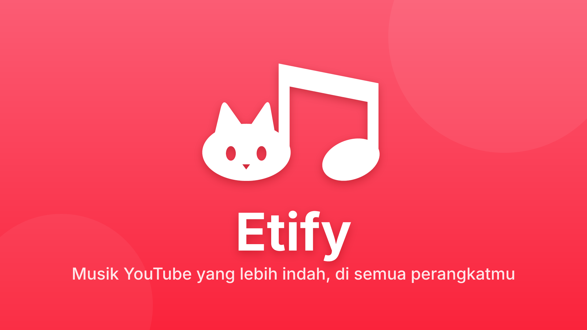

<div align="center">


# Etify

**Pemutar musik YouTube yang lebih indah, di semua perangkatmu.**

[](https://github.com/efendiyhy/etify/releases)
[](LICENSE)

[Unduh](#unduh) · [Fitur](#fitur) · [Platform](#platform) · [Build sendiri](#build-dari-source) · [Kredit](#kredit) · [Lisensi](#lisensi)



</div>

> [!IMPORTANT]
> Etify adalah klien pihak ketiga yang independen. Etify tidak berafiliasi dengan, tidak didukung oleh, dan tidak terhubung dengan YouTube atau Google.

## Tentang Etify

Etify adalah klien YouTube Music open-source dengan tampilan yang rapi dan audio yang serius. Tersedia sebagai aplikasi Android dan sebagai situs web di [etify-3c7ec.web.app](https://etify-3c7ec.web.app). Kamu bisa masuk dengan akun Google, menyambungkan Spotify, mendengarkan lirik yang tersinkron per kata, dan memutar musik bersama teman secara real-time.

## Fitur

### Pemutaran
- **Cari, jelajahi, dan putar** semua yang ada di YouTube Music.
- **Audio lossless Hi-Res** (FLAC/ALAC) dari sumber modul yang dikonfigurasi, dengan YouTube Music sebagai cadangan.
- **Gapless dan crossfade** yang bisa diatur dari 0 sampai 12 detik.
- **Automix (beta)**: transisi ala DJ dengan beat-matching dan tempo-stretching.
- **Unduhan offline** lengkap dengan metadata.
- **Pustaka musik lokal** dan **pemutaran di latar belakang**.
- **Output USB bit-perfect** ke DAC eksternal, sesuai sample rate dan bit depth tiap lagu.

### Lirik dan tampilan
- **Lirik tersinkron per kata** dari banyak penyedia, dengan animasi yang halus.
- **Kanvas album bergerak** di layar Now Playing.
- **Tema dinamis** yang warnanya diambil dari sampul album.
- **UI kaca buram** dengan Material 3.
- **Pilihan ikon aplikasi**: glass, neon, dan monokrom.

### Akun dan koneksi
- **Masuk dengan akun Google** untuk rekomendasi pribadi.
- **Integrasi Spotify** untuk memutar playlist dan Liked Songs.
- **Discord Rich Presence** dan **scrobbling** ke Last.fm serta ListenBrainz.
- **Listen Together**: buat kode pesta 6 karakter, lalu dengarkan lagu yang sama bersama sampai 5 perangkat.

### Kontrol
- Kualitas audio terpisah untuk Wi-Fi dan data seluler.
- Kecepatan putar 0,5× sampai 2,0×, lewati bagian hening, sleep timer, dan equalizer sistem.
- **Stats for nerds**: codec, bit depth, sample rate, dan lainnya.

## Platform

| Platform | Folder | Teknologi |
|---|---|---|
| Android (ponsel) | `app/` | Kotlin, Jetpack Compose, Media3 |
| Web | `web/app/` | React 19, Vite, TypeScript, Tailwind CSS |
| Ekstensi browser | `web/extension/` | WXT, Manifest V3 (Chrome, Edge, Brave, Firefox) |
| Server Listen Together | `backend/` | Go, WebSocket |
| Kode bersama | `shared/`, `sharedUi/`, `native/` | Kotlin Multiplatform, C++ untuk analisis audio |

## Unduh

Ambil APK terbaru dari halaman [Releases](https://github.com/efendiyhy/etify/releases). Untuk memasangnya, izinkan "Install unknown apps" pada aplikasi yang kamu pakai untuk mengunduh.

## Build dari source

### Aplikasi Android

Kebutuhan: JDK 17, Android SDK 36, NDK, dan CMake 3.22.1 atau lebih baru.

```bash
./gradlew assembleDevDebug
```

```bash
./gradlew testDevDebugUnitTest
```

Untuk build rilis yang ditandatangani, salin `keystore.properties.example` menjadi `keystore.properties` lalu isi dengan keystore milikmu.

### Web dan ekstensi browser

Kebutuhan: Node 22 atau lebih baru. pnpm sudah tersedia lewat corepack.

```bash
corepack pnpm --dir web install
```

```bash
corepack pnpm --dir web/app dev
```

Situs berjalan di `http://localhost:5173`. Panduan lengkap untuk ekstensi, konfigurasi, dan deploy ke Cloudflare Pages ada di [`web/README.md`](web/README.md).

### Server Listen Together

```bash
cd backend && go run .
```

Cara kerja sinkronisasi dan langkah deploy ada di [`backend/README.md`](backend/README.md).

### Deploy web ke Firebase Hosting

Situs web di-hosting di proyek Firebase `etify-3c7ec` dan tampil di `https://etify-3c7ec.web.app`. Konfigurasinya ada di `web/firebase.json` dan `web/.firebaserc`. Dari folder `web/`:

```bash
VITE_PARTY_SERVER_URL=https://jam.etify.example.com corepack pnpm build:site
```

```bash
firebase deploy --only hosting
```

Perintah `firebase` didapat dari `npm install -g firebase-tools`, lalu `firebase login`. Detailnya ada di [`web/README.md`](web/README.md).

### Domain server

Server Listen Together, API, dan login Discord masih memakai alamat contoh `jam.etify.example.com`, `api.etify.example.com`, dan `auth.etify.example.com`. Server Go di `backend/` tidak bisa berjalan di Firebase Hosting, jadi jalankan di Cloud Run, Render, atau VPS, lalu ganti alamat-alamat contoh itu dengan alamat servermu.

## Kontribusi

Kontribusi sangat diterima. Baca [Panduan Kontribusi](CONTRIBUTING.md) dan [Kode Etik](CODE_OF_CONDUCT.md) sebelum membuka Pull Request. Daftar pengelola ada di [MAINTAINERS.md](MAINTAINERS.md).

## Kredit

Etify adalah fork dari [**BitChord**](https://github.com/kushagrasinghx/BitChord) karya Kushagra Singh dan para kontributor BitChord, yang dirilis di bawah GPLv3. Sejak November 2026, Etify diubah nama, diberi logo baru, dan dimodifikasi oleh [@efendiyhy](https://github.com/efendiyhy). Keterangan hak cipta asli di dalam file source tetap dipertahankan, sesuai ketentuan lisensi.

Terima kasih juga kepada:
- [binimum/am-lyrics](https://github.com/binimum/am-lyrics) untuk animasi lirik.
- Penyedia lirik: [lrc.red](https://lrc.red), [BetterLyrics](https://github.com/better-lyrics/better-lyrics), [PaxSenix](https://lyrics.paxsenix.org), [LyricsPlus](https://github.com/ibratabian17/YouLyPlus), [SimpMusic](https://github.com/maxrave-dev/SimpMusic), [Unison](https://unison.boidu.dev), [Megalobiz](https://www.megalobiz.com), [KuGou](https://www.kugou.com), [LRCLIB](https://lrclib.net), [Musixmatch](https://www.musixmatch.com), dan [Genius](https://genius.com).
- [Mornye](https://github.com/mornyeapp/Mornye) sebagai referensi output USB bit-perfect.

## Disclaimer

- Etify **tidak menyimpan atau meng-hosting** file musik berhak cipta. Etify hanya menjadi antarmuka untuk penyimpanan lokal dan API publik atau API yang diakses dengan akun penggunanya sendiri.
- Perangkat lunak ini dibuat untuk penggunaan pribadi dan edukasi. Pengguna bertanggung jawab memastikan pemakaiannya sesuai hukum hak cipta setempat dan Ketentuan Layanan YouTube.
- Etify tidak berafiliasi dengan Google LLC, YouTube Music, Spotify, Deezer, Telegram, maupun perusahaan induknya.

## Lisensi

Etify adalah perangkat lunak bebas di bawah **GNU General Public License v3.0**. Siapa pun boleh memakai, mengubah, dan menyebarkannya, asalkan setiap distribusi menyertakan source code lengkapnya di bawah lisensi yang sama. Lihat [LICENSE](LICENSE).
